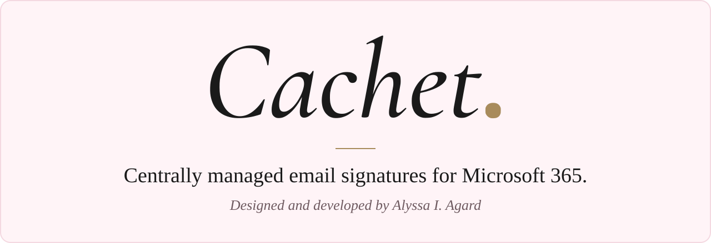

  

  <a href="https://alyssaagard.github.io/cachet-showcase/"><b>Try the interactive demo</b></a>
  &nbsp;&middot;&nbsp;
  <a href="METHODOLOGY.md"><b>Read how I built it</b></a>

---

## What Cachet does

An administrator designs the organization's email signatures once. Cachet fills in each person's details from Microsoft 365 and inserts the right signature automatically whenever anyone writes a message in Outlook on the web. It is also built for Outlook on Windows, Mac, iPhone, and Android; phone testing is next.

- **One editor for every signature.** Templates are built line by line from text, links, icons, a logo, and a legal disclaimer, with a live preview. Placeholders such as `{{name}}`, `{{title}}`, and `{{mobile}}` fill in for each person, and empty details disappear.
- **The right signature for each person.** Separate signatures for new messages and for replies and forwards can be assigned by organization, email domain, Microsoft 365 group, or individual mailbox, with an organization-wide setting for meeting invitations.
- **Automatic in Outlook.** An add-in inserts the signature when a message, reply, forward, or meeting invitation is started, and swaps it when the From address changes.
- **Kept current by the directory.** Names, titles, phone numbers, groups, and shared mailboxes sync from Microsoft 365 through read-only access that an administrator approves once. Sync runs on demand, and a nightly sync is ready to schedule.
- **A server-side safety net.** Generated Exchange mail rules sign any message the add-in missed, skip messages already signed, and ignore mail forged from outside the organization.

Cachet is live at **Agard Research Associates Inc.**, the nonprofit I founded, and is rolling out to more than 40 mailboxes across four email domains.

## Why I built it

An email signature is part of an organization's public record. It carries the organization's name and brand, each person's role and contact details, and often a legal disclaimer. Without central management, every signature depends on each person configuring it correctly on every device and keeping it current. Shared mailboxes and phones make that harder.

Cachet makes signatures correct by default:

- **Efficiency.** One change reaches everyone. New staff get the right signature as soon as they appear in the directory, with no setup and no help desk request.
- **Compliance.** Required information and disclaimers appear on every message, including those sent from phones and shared mailboxes, with a server-side safety net ready for anything the add-in cannot reach.
- **Uniformity.** Everyone presents the organization the same way, in email-safe markup that displays consistently across mail programs.

Commercial signature services charge per user, every month, which is hard to justify for a small nonprofit. I wanted a solution that Agard Research Associates Inc. could run at a fraction of that cost and that could later become a product for other organizations.

## My first application

My background is in history and public policy, not computer science. Cachet is the first application I have built, and it required learning a new skill set from the ground up: the terminal, Git and GitHub, how web applications, databases, and APIs fit together, Microsoft 365 and Microsoft Entra ID administration, Microsoft Graph, the Office add-in platform, Exchange Online PowerShell, Azure hosting, DNS, and email authentication.

I defined the product, wrote the code, made the design, security, and hosting decisions, tested every feature in the admin site and in Outlook, and ran the deployments. The [methodology](METHODOLOGY.md) describes the process, including what went wrong and what I changed as a result.

Cachet reflects what I bring to any professional setting: identifying an operational problem, learning whatever it takes to solve it, and delivering a solution people can rely on.

## At a glance

| | |
|---|---|
| **Built** | May to October 2026 |
| **Role** | Founder, product owner, and sole developer |
| **Platforms** | Outlook on the web (verified); built for Outlook on Windows, Mac, iPhone, and Android |
| **Admin site and API** | Next.js and React, TypeScript |
| **Data** | PostgreSQL, with every record tied to its own organization |
| **Identity** | Microsoft Entra ID for administrators; Microsoft-issued tokens verified on every add-in request |
| **Directory** | Microsoft Graph, read-only |
| **Hosting** | Azure Container Apps, Azure Database for PostgreSQL, and private Azure Blob Storage |
| **Quality** | About 100 automated tests; a continuous integration workflow ready to switch on |
| **Size** | About 9,000 lines of TypeScript, 12 database migrations, and more than 60 commits |

## About this repository

This repository is a showcase. **Cachet's source code is private and is not included here.**

- [`index.html`](index.html) is the interactive demo, published with GitHub Pages. It is a standalone simulation with a fictional organization and sample people, so anyone can try Cachet without signing in to Microsoft 365.
- [`METHODOLOGY.md`](METHODOLOGY.md) explains how Cachet was planned, designed, secured, tested, and deployed.

## Rights

Copyright (c) 2026 Alyssa I. Agard. All rights reserved. Cachet is proprietary software. This repository is public for viewing only and grants no license to use, copy, or adapt Cachet or these materials. See [LICENSE](LICENSE). Licensing inquiries: aa@alyssaagard.dev.
